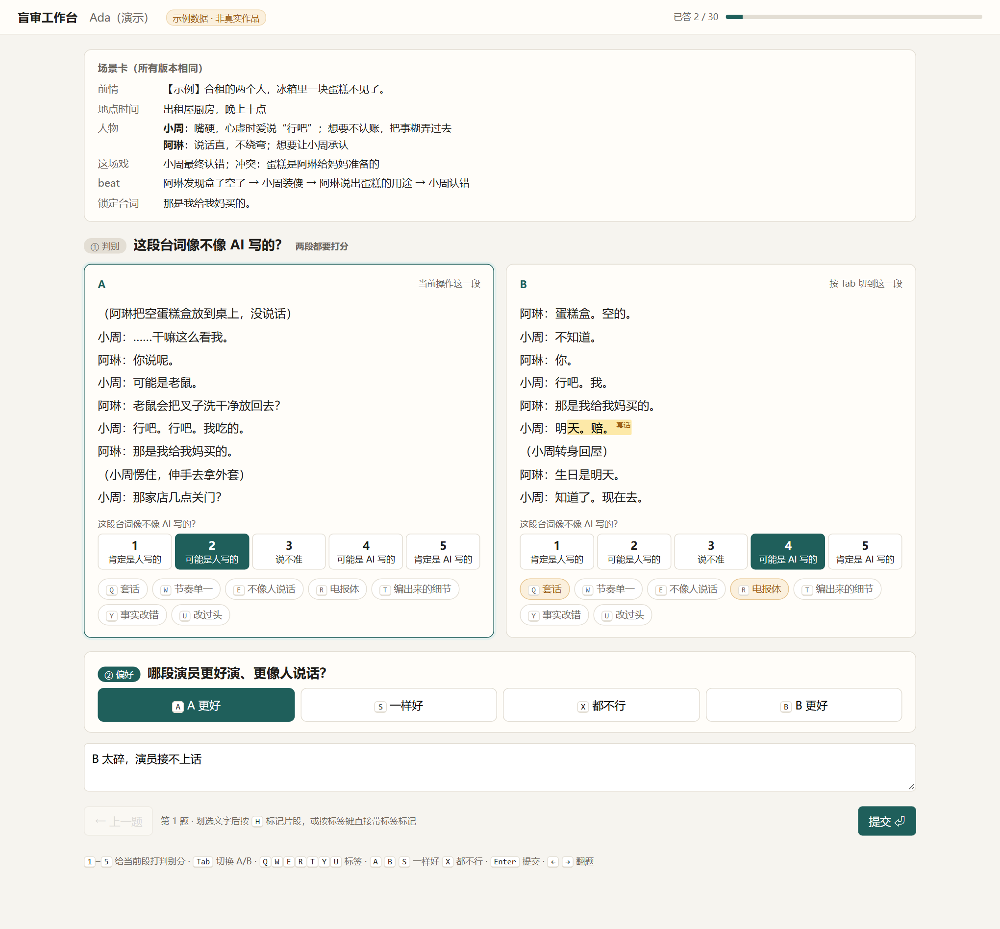

# 盲审工作台

台词和口播候选稿的本地盲审工具。依据：[评测方案](../docs/评测方案-台词与口播.md) 第 4、6 节。

- 只用 Python 标准库 + SQLite + 两个静态页面，不需要装依赖（跑测试要 `pytest`）
- 只监听 `127.0.0.1`，不部署、不上公网、不调用任何模型或付费 API
- 自带的数据全部是**示例**（`workbench/seed/`），不是真实作品，分析结果不能当结论



## 启动

在仓库根目录：

```bash
python -m workbench seed
```

```bash
python -m workbench serve --admin-token 换成你自己的口令
```

- 评审页：<http://127.0.0.1:8765/>，输入评审码
- 管理页：<http://127.0.0.1:8765/admin>，输入管理口令（不传 `--admin-token` 时启动会随机生成并打印）

数据库默认在 `workbench/data/workbench.sqlite3`（已加入 `.gitignore`），可用 `--db` 或环境变量 `WB_DB` 换位置。

## 完整走一遍

```bash
python -m workbench import workbench/seed/示例_briefs与稿件.json workbench/seed/示例_候选稿.csv
python -m workbench rater "评审甲" --expertise 编辑
python -m workbench batch --rater 1 --line 台词 --pairs 24 --singles 4
python -m workbench serve
# 评审在浏览器里作答……
python -m workbench export      # judgments.csv / judgments.jsonl / preference.jsonl
python -m workbench analyze --write-back   # report.md / report.json
```

导入、建评审、生成批次、看进度、导出、跑分析，在管理页上都能点。没有真人评审时，可以用 `python -m workbench simulate --raters 3` 生成模拟作答来演示分析（模拟评审在库里和报告里都会标出来，偏好导出默认排除）。

## 数据模型

| 表 | 内容 | 评审能看到吗 |
|---|---|---|
| `item` | brief（`brief_json` 完整版；`public_json` 去掉 `source` 后的公开版） | 只看公开版 |
| `variant` | 原文和统一格式后的 `display_text` | 只看 `display_text` |
| `variant_source` | **揭盲表**：source_type（human / raw_ai_baseline / oneline_baseline / candidate / gold_bad）、候选 id、skill git hash、模型、参数 | 永远不读 |
| `rater` | 评审码、专长，分析回写的校准分、位置偏差、自洽度 | — |
| `batch` | 一位评审的一批题，记下随机种子 | — |
| `task` | single_turing / pairwise_pref；A/B 位放的是哪篇、`swapped`、展示顺序、对照题类型、`is_gold`、`gold_expected`、`is_repeat_of` | 只拿到不透明的 `public_id` |
| `judgment` | 两段各自的 AI 置信 1–5、偏好 A/B/一样好/都不行、标签芯片、划选片段、理由、用时、`too_fast` | 自己的 |

## 盲审规则（都在服务端）

- **去盲**：导入时统一格式（去 Markdown、半角转全角、统一引号省略号破折号、台词统一成“角色名：台词 / （动作线）”）；评审接口只返回 `public_id`、规整后的文本、brief 公开部分，不返回 variant id、item id、来源、对照题类型。管理接口要口令。
- **随机化**：每位评审、每道题独立抽左右位置并写进 `task.swapped`；题目顺序整体打乱；种子存在 `batch.seed`，同一库状态下可复现。同一评审不会重复拿到同一对稿件；长度比超过 `--max-len-ratio`（默认 1.5）的不配对，因为长度本身会泄露来源，跳过的对数记在批次参数里。
- **对照题**：每批占 10–15%（默认 12.5%），四类轮流出：真人锚点（单篇判别）、AI 蜜罐（单篇判别）、左右调换的重复题（排在原题后至少 5 题）、金标题（真人原稿 vs 自动改坏的版本，有标准答案）。对照题少于 4 道时先出哪几类随机，所以想每批四类都有，正式题至少 27 道左右。正式题恰好 10、11 道时凑不出 10–15%，会少出一两道。
- **作答顺序**：先判别（两段都要打 1–5），再偏好；偏好按钮在判别打完前是锁住的，服务端也会拒绝。台词附场景卡，问“哪段演员更好演、更像人说话”；口播附 brief 并提示读出声，问“哪段你更愿意听完”。
- **过快**：少于 4 秒，或折合阅读速度超过 1500 字/分钟，记 `too_fast`；分析默认剔除。阈值在 `service.py` 顶部，是经验值，等有了真人作答再校。

## 评审快捷键

按物理键位识别，开着中文输入法也能用。

| 键 | 作用 |
|---|---|
| `1`–`5` | 给当前段打判别分（A 打完自动跳到 B） |
| `Tab` | 切换当前段 |
| `Q W E R T Y U` | 标签：套话 / 节奏单一 / 不像人说话 / 电报体 / 编出来的细节 / 事实改错 / 改过头 |
| 先用鼠标划选，再按标签键或 `H` | 把这段标成片段（带标签或不带）；点高亮可取消 |
| `A` `B` `S` `X` | A 更好 / B 更好 / 一样好 / 都不行 |
| `/`、`Esc` | 进入、退出理由框 |
| `Enter` | 提交 |
| `←` `→` | 翻题（回看可改，用时累加） |

## 导出

- `judgments.csv`（带 BOM，Excel 可直接开）/ `judgments.jsonl`：每条作答一行，带两侧的揭盲来源、`preferred_source`、金标题对错、重复题指向
- `preference.jsonl`：`{"prompt", "chosen", "rejected", "meta"}`，prompt 由 brief 公开部分生成；去掉金标题、重复题、平局、都不行、过快作答，默认也去掉模拟评审

## 分析口径（`analysis.py`）

每条线分开算，“系统” = `source_label`。

- **Bradley-Terry**：只用正式两两题；一样好记各半胜，都不行不进 BT 但单列比例；MM 算法加很弱的平局先验。分数是 Elo 尺度（1000 = 几何平均，差 400 ≈ 10:1）。95% CI 用按条目（brief）的 cluster bootstrap。
- **检出率**：判别分 ≥4 的比例，含 bootstrap CI；“相对位置” = (系统 − 真人锚点) / (AI 蜜罐 − 真人锚点)，0 像真人，1 像 AI 原稿。另给胜率、对真人胜率。
- **Krippendorff α**：判别分（有序，单位 = 稿件）、偏好（有序，单位 = 一对稿件）、每个标签（名义 0/1）。≥0.80 可依赖，0.667–0.80 暂定，<0.667 要重写锚点或删掉。实现用 Krippendorff (2011) 的示例数据做了校验。
- **评审质量**：金标题正确率、认出蜜罐率、锚点判人率（合成校准分）、选左比例和二项检验 p（位置偏差）、重复题一致率（自洽度）、过快比例；越线的自动打标记。`--write-back` 写回 `rater` 表。
- **残留 AI 腔**：各系统每次判别平均被打的标签数，以及被划选最多的片段。

## 测试

```bash
python -m pytest
```

覆盖：评审接口不泄露任何来源字符串、越权访问、管理口令；左右位置记录一致、整体接近 50%、不同评审互相独立、种子可复现；对照题比例、四类构造、重复题间隔、金标题答案；格式统一；作答校验；α 参考值；导入 → 批次 → 作答 → 导出 → 分析整条流程。

## 还没做 / 要 Ada 定的

- 自适应擂台（当前最好 vs 挑战者、提前停掉落后者）还没自动化：现在靠生成批次时勾选“参与比较的来源”手动实现
- 口播 TTS 音频（方案第 7 节，决赛再说）
- 评审的 Fisher 合并 p 值检查没做，只有分项阈值标记
- 过快阈值、长度比上限都是经验值
